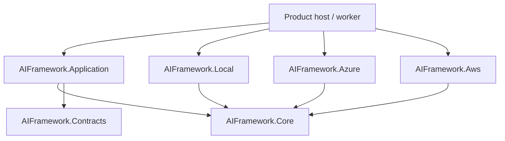

# Architecture and integration

## Dependency contract

Core and Contracts use BCL types only. Application depends on DI abstractions and the two inner libraries, with no cloud, EF or ASP.NET dependency. Provider assemblies never reference each other. The sample composes libraries and demonstrates HTTP contracts but is never referenced by production libraries. Architecture tests enforce these assembly boundaries.

Use project/package references to libraries, not the sample host. The AI solution does not import Framework's build files and can build with no sibling repositories present. This separation intentionally changes source namespaces from `BuildingBlocks.AI.*`/`Framework.Application.AI.*`/`Framework.Contracts.AI` to `AIFramework.*`; JSON contract shapes remain unchanged.

## Use-case responsibilities

| Scenario | Reuse | Application-specific responsibilities |
| --- | --- | --- |
| eDiscovery | Scoped retrieval, evidence identifiers, source-grounded answers | Matter/document ACLs, legal hold, chain of custody, immutable originals, page/offset provenance, retention and legal review |
| Shared energy / Kosovo | Document profiles, extraction ports, explanatory answers | Meter data, deterministic energy allocation, billing, local rules, consent and approval |
| MixPilot DJ | Model abstraction, answer orchestration, source citations | Owner-scoped set evidence, track rights, music analysis and DJ prompts |
| Multi-business | Document workflow and explanatory answers | Entity/branch membership, invoice schemas, deterministic financial calculations, posting approvals and country rules |
| Education | Profiles, course-scoped retrieval and explanations | Course enrollment, age/privacy constraints, learning policies and assessment rules |

These are integration examples, not implemented domain capabilities or compliance certifications. Core does not prescribe invoices, tracks, legal matters, meters or courses.

## Extending safely

1. Implement `IDocumentProfileCatalog` for supported operations, languages and review labels. Register the product catalog after defaults, or before `AddAiApplication` (which uses TryAdd).
2. Resolve authenticated identity to a validated tenant and authorized resource/document scope in the application service.
3. Supply an `IKnowledgeRetriever` that enforces those boundaries before searching. A single optional ScopeId is a basic boundary, not a universal ACL hierarchy; richer authorization should resolve to an allowed document set or a product-specific retriever.
4. Use `IChatModel` for generation and `ITextEmbeddingModel` for retrieval embeddings. Embedding dimensions/version must match the index; changing models requires an explicit index migration/reingestion plan.
5. Implement `IDocumentTextExtractor` when OCR/file extraction is required. The host owns stream limits, content-type validation, malware scanning and encrypted object storage.
6. Introduce persistent metadata and durable jobs around ingestion before accepting production workflows. Avoid automatic retries of non-idempotent processing without durable identity/checkpoints.

The Application layer rechecks returned chunks against tenant, profile, scope and allowed document IDs before generation. This catches faulty custom retrievers but does not substitute for provider-side filters, which prevent data from leaving its permitted boundary in the first place.

## Decisions and operational limits

- Separate repository/solution and independently packable libraries; initial version 0.1.0, targeting net9.0 and net10.0 with a .NET 10 SDK, or net9.0 only with a .NET 9 SDK. Removing net9.0 requires a separate coordinated decision.
- Keep the existing tested Local/Azure behavior while adding AWS chat behind the same interface. Do not add heavyweight agent frameworks or vector/database products without a concrete use case.
- Azure model and search registration are independently available. AWS chat can use application-owned evidence or a separately selected retrieval adapter.
- Provider adapters manage transport and authentication, while the host owns approval, identity, budgets, data residency and business permissions. No unrestricted tool execution is supplied.
- Preserve observable limitations: synchronous text ingestion; local state is transient; Azure chunk writes can partially fail; no automatic delete/replace lifecycle or independent claim verification.
- Testing includes scoped sample HTTP workflows, cross-tenant retrieval, Azure request filters, Bedrock request/response behavior, and architecture contracts. Extend evaluations with permission leakage, source attribution, injection attempts and real corpus accuracy before production use.
